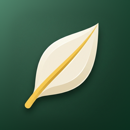

<p align="center"></p>

# Lingleaf for Android

**Learn English by reading real books.** Tap any word to see its translation,
pronunciation and meaning, and highlight what you learn. Free and open source.

> 🇪🇸 **Aprende inglés leyendo libros de verdad.** Toca cualquier palabra para ver su
> traducción, pronunciación y significado, y subraya lo que aprendes. Gratis y open source.

iOS version: [lingleaf-ios](https://github.com/erobinsonc/lingleaf-ios) · Product spec: [SPEC.md](SPEC.md)

## Features

- **Tap a word**: base form, IPA, on-device translation, definition, and the sentence translated.
- **Save word / I know it**: saved words get a yellow underline in every book, inflected forms too. Every change can be undone.
- **Review** with spaced repetition (1, 3, 7, 14, 30 days).
- **Read aloud** a word, a sentence or a paragraph.
- **Thousands of free books** from Project Gutenberg, plus 3 original graded stories (A1–B1). Import your own `.txt`.
- **Recommended classics from B1 to C2**, public domain worldwide, filterable by level in Discover.
- **Daily goal and streak.**
- No accounts, no ads, no tracking.

## Build

Requirements: Android Studio (recent) with JDK 17.

```bash
./gradlew :app:installDebug          # build and install on a device/emulator
./gradlew -p core check koverVerify  # logic tests + coverage (no Android SDK needed)
./gradlew :app:testDebugUnitTest     # UI and accessibility tests (Robolectric)
./gradlew :app:ktlintCheck :app:lintDebug
```

## Architecture

- `core/` — pure Kotlin, no Android: text tools, base forms, spaced repetition,
  streak, Gutenberg catalog, dictionary client, library storage. ≥90% test coverage is enforced.
- `app/` — Jetpack Compose UI, ML Kit translation, system text-to-speech, HTTPS-only networking.

## Quality gates (every pull request)

| Gate | Tool |
|---|---|
| Logic tests + coverage ≥90% | JUnit, Kover |
| UI flow + accessibility tests | Compose UI tests on Robolectric |
| Code style | ktlint |
| Android Lint (accessibility issues are errors) | Android Lint |
| Secrets | gitleaks |
| Vulnerable dependencies | Dependabot, dependency review* |
| Static security analysis | CodeQL* |
| Build | debug APK uploaded as an artifact |

\* Runs automatically once the repository is public (free for open source).

## Privacy

Lingleaf has no accounts, ads or analytics, and keeps your books and words on your
device (and in your Android backup, if you have backup turned on). Lingleaf is for ages 13 and up
(the open Project Gutenberg catalog includes books for adults). The app itself
talks only to `gutendex.com` / `www.gutenberg.org` (books) and `api.dictionaryapi.dev`
(definitions), always over HTTPS.

Translation runs on the device with Google ML Kit. ML Kit starts only after you first tap a
word: it then downloads the language model (about 30 MB) from Google, over Wi‑Fi only, and, as
Google documents for ML Kit, sends Google diagnostics data (device model, OS and app version,
performance metrics and a per-installation identifier)
([ML Kit terms](https://developers.google.com/ml-kit/terms)). The first word card says so. The
words you look up are translated on the device and are not sent.
Full policy: [PRIVACY.md](PRIVACY.md), also linked in the app (Settings → About).

## Credits

Definitions come from [Wiktionary](https://en.wiktionary.org/) under
[CC BY-SA 3.0/4.0](https://creativecommons.org/licenses/by-sa/4.0/), via the
[Free Dictionary API](https://dictionaryapi.dev/); the app may shorten them and says so on the word card.
The open-source licences of the libraries inside the app are in Settings → About → Open-source licenses.

## License

[MIT](LICENSE) for the code. The MIT licence does not cover the Lingleaf name and icon:
please don't use them for your own builds or forks. Bundled stories in `app/src/main/assets/books`
are original and dedicated to the public domain ([CC0 1.0](app/src/main/assets/books/LICENSE)).
Project Gutenberg books are public domain in the US; outside the US, check your country's laws.
The recommended books are public domain worldwide (every author died in 1925 or earlier).
